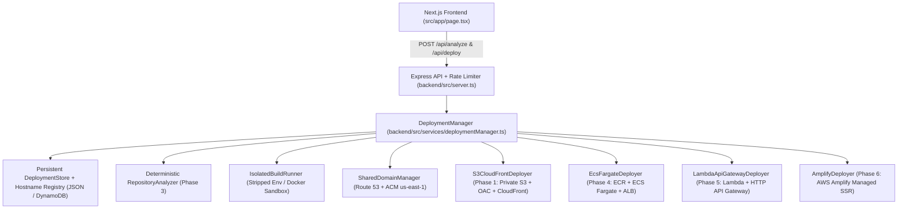

# Repo2Cloud — Automated AWS Deployment Platform (Technica 2026)

Repo2Cloud is an automated AWS deployment platform where users submit a public GitHub repository URL, the system deterministically detects the application stack, recommends the optimal AWS hosting target (`S3_CLOUDFRONT`, `ECS_FARGATE`, `LAMBDA_API_GATEWAY`, or `AMPLIFY`), builds the application in an isolated worker, provisions the cloud infrastructure, maps a custom subdomain via **Amazon Route 53 + AWS Certificate Manager (ACM)**, verifies HTTPS reachability, and returns a live URL.

---

## Architecture Overview



---

## Phase-by-Phase Implementation Map

| Phase | Feature | Key Files |
| :--- | :--- | :--- |
| **Phase 1** | Static-site deployment (`S3 + CloudFront` with Origin Access Control & SPA routing) | [`s3CloudFrontDeployer.ts`](backend/src/deployers/s3CloudFrontDeployer.ts), [`isolatedBuilder.ts`](backend/src/services/isolatedBuilder.ts) |
| **Phase 2** | Custom subdomains with server-controlled Route 53 hosted zones & ACM (`us-east-1`) | [`domainManager.ts`](backend/src/services/domainManager.ts), [`validation.ts`](backend/src/utils/validation.ts) |
| **Phase 3** | Deterministic `RepositoryAnalyzer` inspecting `package.json`, `vite.config.*`, `next.config.*`, `Dockerfile`, `serverless.yml`, Python, and monorepo manifests | [`repositoryAnalyzer.ts`](backend/src/services/repositoryAnalyzer.ts) |
| **Phase 4** | Containerized deployments with Amazon ECR, ECS Fargate (`awsvpc`), and ALB health checks | [`ecsFargateDeployer.ts`](backend/src/deployers/ecsFargateDeployer.ts) |
| **Phase 5** | Serverless deployments with AWS Lambda + HTTP API Gateway (with Express scope protection) | [`lambdaApiGatewayDeployer.ts`](backend/src/deployers/lambdaApiGatewayDeployer.ts) |
| **Phase 6** | Managed SSR & frontend deployments with AWS Amplify | [`amplifyDeployer.ts`](backend/src/deployers/amplifyDeployer.ts) |
| **Phase 7** | Reliability & security: persistent job store, atomic hostname reservation, build env credential stripping, rate limiting, retries, and resource cleanup | [`deploymentStore.ts`](backend/src/store/deploymentStore.ts), [`deploymentManager.ts`](backend/src/services/deploymentManager.ts) |
| **Phase 8** | Polished Next.js dashboard with stack preview, 4-step verification checklist, live logs, copy-URL, and one-click resource cleanup | [`page.tsx`](frontend/src/app/page.tsx), [`api.ts`](frontend/src/lib/api.ts) |

---

## Quick Start

### 1. Configure Environment Variables

Copy `.env.example` to `.env`:

```bash
cp .env.example .env
```

- **Local Demo / Dry-Run Mode (`AWS_DRY_RUN=true`, default)**: Runs the full deterministic analyzer, isolated workspace builder, hostname reservation, and simulated AWS provisioning without requiring live AWS credentials.
- **Live AWS Mode (`AWS_DRY_RUN=false`)**: Provide `AWS_ACCESS_KEY_ID`, `AWS_SECRET_ACCESS_KEY`, `AWS_REGION`, and `CONFIGURED_DOMAINS` in `.env` to execute live AWS SDK v3 provisioning.

### 2. Install Dependencies & Start Servers

```bash
npm install
npm run dev
```

- **Backend API**: `http://localhost:4000`
- **Next.js Frontend**: `http://localhost:3000`

### 3. Run Automated Verification Tests

```bash
npm test
```

---

## API Contract Reference

### `POST /api/analyze`
Inspects a GitHub repository and returns deterministic stack intelligence before deployment:
```json
{
  "framework": "Vite + React",
  "applicationType": "static-frontend",
  "buildCommand": "npm run build",
  "outputDirectory": "dist",
  "recommendedTarget": "S3_CLOUDFRONT",
  "confidence": 0.96,
  "warnings": []
}
```

### `POST /api/deploy`
```json
{
  "repoUrl": "https://github.com/example/vite-app",
  "deploymentType": "static",
  "subdomain": "demo",
  "domain": "repo2cloud.dev"
}
```
Response (`202 Accepted` — `url` is `null` until verification completes):
```json
{
  "deploymentId": "dep_a1b2c3d4e5f6",
  "status": "QUEUED",
  "target": "S3_CLOUDFRONT",
  "url": null,
  "customHostname": "demo.repo2cloud.dev"
}
```

### `GET /api/deploy/:id`
Returns current status (`QUEUED → ANALYZING → BUILDING → DEPLOYING → CONFIGURING_DOMAIN → VERIFYING → LIVE`), checklist, audit logs, and populates `url` **only** once `status === "LIVE"`.

### `POST /api/deploy/:id/retry` & `DELETE /api/deploy/:id`
Retries failed deployments or tears down provisioned AWS resources and frees the reserved Route 53 subdomain.
