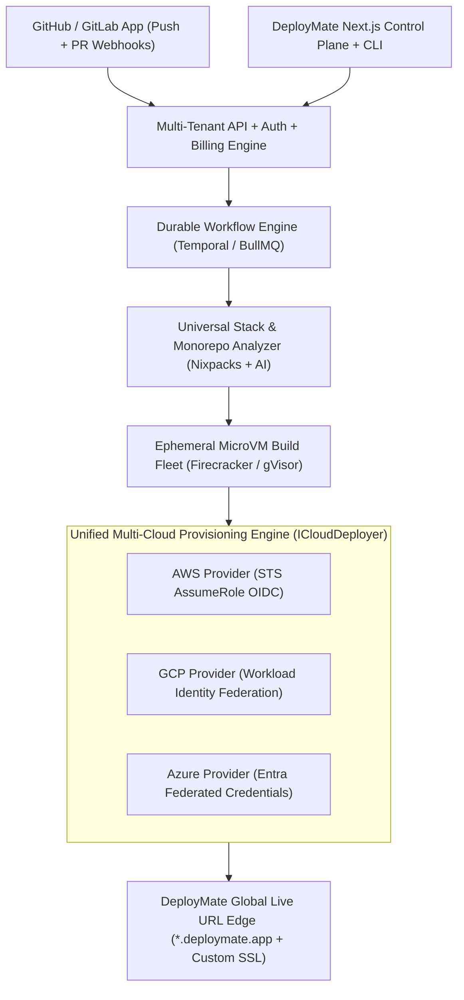
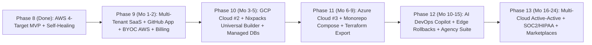

# DeployMate Strategic & Technical Master Plan: From Phase 8 AWS MVP to \$500,000+/Month Multi-Cloud Platform

> [!IMPORTANT]
> **The Core Thesis:** Vercel and Netlify win on developer experience (`git push` -> Live HTTPS URL), while AWS, GCP, and Azure win on raw power, unit economics, and startup credits. **DeployMate bridges the chasm:** giving developers, startups, and enterprises Vercel-grade 1-click Live URLs, PR Previews, and Self-Healing CI/CD for **any workload** (static, SSR, Docker containers, serverless, background workers, and databases) across **AWS, GCP, and Azure**—either on **DeployMate Managed Cloud** or directly inside the customer's **Own Cloud Account (BYOC)**.

---

## 1. Baseline Audit: Where DeployMate Stands Today (Phases 1–8)

An audit of the current repository reveals a remarkably clean foundation built through **Phases 1–8**, paired with specific architectural bottlenecks that must be resolved before taking paying multi-tenant traffic.

### What You Already Built (Strategic Assets to Preserve)
1. **Pluggable Deployer Contract:** [`IDeployer`](backend/src/deployers/baseDeployer.ts#L33-L58) and [`DEPLOYER_REGISTRY`](backend/src/deployers/index.ts#L12-L17) cleanly decouple orchestration from cloud SDK calls across 4 AWS targets:
   - Static Edge: [`s3CloudFrontDeployer.ts`](backend/src/deployers/s3CloudFrontDeployer.ts) (Private S3 + SigV4 OAC + CloudFront)
   - Containers: [`ecsFargateDeployer.ts`](backend/src/deployers/ecsFargateDeployer.ts) (ECR + ECS Fargate + ALB)
   - Serverless: [`lambdaApiGatewayDeployer.ts`](backend/src/deployers/lambdaApiGatewayDeployer.ts) (PKZIP + Lambda + HTTP API v2)
   - Managed SSR: [`amplifyDeployer.ts`](backend/src/deployers/amplifyDeployer.ts) (Amplify `WEB_COMPUTE`)
2. **Deterministic Stack Detection:** [`RepositoryAnalyzer`](backend/src/services/repositoryAnalyzer.ts#L29-L65) inspects manifests and recommends cloud targets with confidence scores before building.
3. **Self-Healing Pipeline:** [`SelfHealingEngine`](backend/src/services/selfHealingEngine.ts) diagnoses build/config failures and automatically retries inside [`DeploymentManager.executePipeline`](backend/src/services/deploymentManager.ts#L220-L495).
4. **Live URL Verification & Atomic Subdomains:** [`SharedDomainManager`](backend/src/services/domainManager.ts) reserves subdomains atomically, binds `us-east-1` wildcard ACM certs, creates Route 53 aliases, and gates `status === 'LIVE'` until HTTPS verification passes.
5. **Security & Teardown Discipline:** [`SecurityGuardrails`](backend/src/services/securityGuardrails.ts#L30-L161) and [`IsolatedBuildRunner`](backend/src/services/isolatedBuilder.ts) strip secrets, block symlink escapes, and enforce 1-click full AWS resource cleanup.

### Critical Production Gaps Separating Phase 8 from Commercial SaaS

| Gap Area | Current State in Codebase | Required SaaS Architecture |
| :--- | :--- | :--- |
| **Multi-Tenancy & Auth** | [`DeploymentStore`](backend/src/store/deploymentStore.ts#L20-L70) writes to local `deployments.json` with no `userId`, `orgId`, or RBAC. | PostgreSQL (Organizations, Projects, Environments, Billing) + Redis + Clerk/NextAuth/WorkOS SSO. |
| **Cloud Credential Model** | Uses static `process.env.AWS_ACCESS_KEY_ID` pointing to a single platform AWS account. | **Dual-Mode:** (1) DeployMate Managed Cloud Pool for Students/Hobbyists; (2) Zero-key OIDC / Cross-Account Role BYOC for AWS, GCP, & Azure. |
| **Build Orchestration** | `void this.executePipeline(...)` runs inside the Express process using `/tmp` folders. | Distributed queue (BullMQ / Temporal) dispatching builds to ephemeral Firecracker microVMs / gVisor Kubernetes workers. |
| **Git Lifecycle** | Clones public GitHub URLs once; no webhooks or private repo auth. | Official **GitHub App** (plus GitLab/Bitbucket): private repos, auto-deploy on `git push`, automatic **PR Preview Live URLs**, instant rollbacks. |
| **Language Coverage** | [`repositoryAnalyzer.ts`](backend/src/services/repositoryAnalyzer.ts) handles JS/TS, Next/Vite, basic Python, and existing Dockerfiles. | Integrate **Nixpacks / Railpack / Cloud Native Buildpacks** to auto-containerize Go, Rust, Java, Rails, PHP/Laravel, .NET, Elixir, Bun, Deno, and monorepos. |
| **AWS-Coupled Types** | [`DeploymentTarget`](backend/src/types/deployment.ts#L1-L5) & [`TrackedAwsResources`](backend/src/types/deployment.ts#L77-L100) hardcode AWS resource schemas. | Cloud-agnostic `CloudProvider` (`AWS` \| `GCP` \| `AZURE`), unified workload archetypes, and polymorphic resource state + Terraform/OpenTofu export. |

---

## 2. Competitive Positioning: How DeployMate Beats Vercel & Netlify

To reach **\$500,000+/month**, DeployMate must not be a "cheaper Vercel clone." It must attack the structural weaknesses where Vercel and Netlify *cannot* follow without cannibalizing their own business model:

1. **The Startup Cloud Credit Wedge (Massive Unfair Advantage):**
   - Over 50,000 funded startups hold **\$10,000 to \$350,000** in **AWS Activate**, **Google for Startups Cloud**, or **Microsoft for Startups Founders Hub** credits.
   - **They cannot spend those credits on Vercel, Netlify, Render, or Railway.** They are forced to pay Vercel \$500–\$5,000/month in cash while their cloud credits expire unused—or hire expensive DevOps engineers.
   - **DeployMate's Pitch:** *"Connect your AWS, GCP, or Azure account in 60 seconds. Get Vercel's exact GitHub -> Live URL & PR Preview magic, while 100% of your hosting bill burns your existing cloud credits."*
2. **No Seat Tax, No 10x Bandwidth Markup:**
   - Vercel charges \$20/developer/month plus steep bandwidth/function markups. DeployMate charges predictable workspace tiers with raw cloud infrastructure pass-through in BYOC mode.
3. **Full-Stack & Stateful (Beyond Frontend):**
   - DeployMate deploys Next.js frontends, long-running WebSockets, Python FastAPI/AI microservices, background queues, cron jobs, and PostgreSQL/Redis databases side-by-side in a private VPC.
4. **True 3-Cloud Portability & Zero Lock-In:**
   - Deploy to AWS today, spin up a mirror on GCP tomorrow, or click **"Export Terraform"** at any time. Enterprises buy platforms they know they aren't trapped inside.

---

## 3. Target Architecture: "Any App on Any of the 3 Clouds"

### Unified Multi-Cloud Control Plane



### The 3-Cloud Workload Equivalence Matrix

Instead of exposing raw cloud complexity to beginners, DeployMate classifies any repository into **5 Universal Workload Archetypes** and maps each archetype to native best-practice primitives across AWS, GCP, and Azure:

| Universal Archetype | Detected Stacks & Frameworks | AWS Native Target | GCP Native Target | Azure Native Target |
| :--- | :--- | :--- | :--- | :--- |
| **`STATIC_EDGE`** | React, Vite, Vue, Angular, Astro, Svelte, Docs, HTML | **S3 + CloudFront (OAC)** *(Built)* | **Cloud Storage + Cloud CDN** | **Blob Storage + Azure Front Door** |
| **`SSR_WEB`** | Next.js App Router, Nuxt, Remix, SvelteKit, Astro SSR | **Amplify Hosting** *(Built)* / **OpenNext (Lambda + CloudFront)** | **Cloud Run (SSR) + Cloud CDN** | **Azure Container Apps / Static Web Apps** |
| **`CONTAINER_SERVICE`** | Dockerfile, Express, NestJS, FastAPI, Django, Go, Rust, Java, Rails, PHP, WebSockets | **ECR + ECS Fargate + ALB** *(Built)* | **Artifact Registry + Cloud Run v2** *(Scale-to-zero)* | **ACR + Azure Container Apps** *(KEDA Scale-to-zero)* |
| **`SERVERLESS_FUNC`** | Lambda/Cloud Functions, Hono, Cron jobs, Event handlers | **Lambda + HTTP API GW v2** *(Built)* | **Cloud Functions Gen 2 + API Gateway** | **Azure Functions (Flex) + API Mgmt** |
| **`DATA_AND_STATE`** | `docker-compose`, Prisma/Drizzle, Celery/BullMQ, Redis, AI Vectors | **RDS / Aurora Serverless v2 + ElastiCache** | **Cloud SQL + Memorystore** | **Azure Postgres Flexible + Azure Redis** |

> [!TIP]
> **How to Support "Any App" Quickly:** Rather than hand-coding build scripts for 20 languages in [`isolatedBuilder.ts`](backend/src/services/isolatedBuilder.ts), integrate **Nixpacks / Railpack** as the fallback builder. Whenever [`repositoryAnalyzer.ts`](backend/src/services/repositoryAnalyzer.ts) encounters Go, Rust, Ruby, PHP, Java, .NET, Elixir, or complex Python apps without a `Dockerfile`, Nixpacks deterministically generates an optimized OCI container image and routes it to `ECS_FARGATE`, `GCP_CLOUD_RUN`, or `AZURE_CONTAINER_APPS`.

### Refactoring the Codebase Interfaces for Multi-Cloud
In [`backend/src/types/deployment.ts`](backend/src/types/deployment.ts) and [`backend/src/deployers/baseDeployer.ts`](backend/src/deployers/baseDeployer.ts), evolve the current single-cloud types into a two-dimensional `(CloudProvider, WorkloadArchetype)` registry:

```typescript
export type CloudProvider = 'AWS' | 'GCP' | 'AZURE';

export type WorkloadArchetype =
  | 'STATIC_EDGE'
  | 'SSR_WEB'
  | 'CONTAINER_SERVICE'
  | 'SERVERLESS_FUNC';

export type ExecutionTenancy =
  | 'DEPLOYMATE_MANAGED' // Runs in DeployMate's pooled cloud accounts (Students / Hobbyists)
  | 'CUSTOMER_BYOC';     // Runs inside customer's AWS/GCP/Azure via OIDC federation (SMB / Enterprise)
```

### Instant Live URLs (`*.deploymate.app`) Without Waiting 10 Minutes for DNS
Currently, AWS CloudFront + ACM propagation can take several minutes. To match Vercel's **instant Live URL** feel across all 3 clouds:
- Put **Cloudflare for SaaS / Envoy Global Edge Proxy** in front of `*.deploymate.app` and `*.preview.deploymate.app`.
- Every `git push` or Pull Request gets a pre-warmed wildcard TLS certificate (`https://pr-42-myapp.deploymate.app`) that routes dynamically to the underlying S3/CloudFront, Cloud Run, or Azure Container App origin in **under 500ms** once the build finishes—enabling **zero-downtime atomic instant rollbacks** across clouds.

---

## 4. Segment Strategy: Features & Packaging from Students to Enterprise

| Tier | Target Persona | Price Point | Hosting Mode | Killer Features That Drive Conversion |
| :--- | :--- | :--- | :--- | :--- |
| **1. Campus & Sandbox** | Students, Bootcampers, Hackathon Devs, OSS | **\$0 / mo** *(or \$7/mo Student Pro)* | DeployMate Managed Cloud (Scale-to-zero) | 1-click GitHub -> Live URL (`*.deploymate.app`), scale-to-zero containers (GCP Cloud Run / Azure Container Apps / Lambda cost pennies idle), 1 shared dev Postgres DB, AI Build Doctor, mandatory `"Deployed with DeployMate ⚡"` viral badge. **\$7/mo Student Pro** removes badge, keeps 1 app warm 24/7, and adds 1 custom domain. |
| **2. Builder / Hobbyist** | Indie Hackers, Freelancers, Solo Founders | **\$19 / mo** + usage | DeployMate Managed Cloud (AWS, GCP, or Azure region selector) **OR** 1 BYOC Account | Unlimited private GitHub repos, automatic **PR Preview Live URLs**, 10 custom domains with auto-SSL, 1-click Managed Postgres/Redis, instant rollbacks, no per-seat fees, AI Self-Healing retries. |
| **3. Growth / Small Business** | Startups (with Cloud Credits!), Agencies, SaaS Teams | **\$99 / mo** base *(includes 5 seats; \$15/extra seat)* | Unlimited **BYOC** (AWS, GCP, Azure) + Managed Add-ons | **Burn AWS/GCP/Azure Startup Credits**, Multi-service blueprints (`web` + `api` + `worker` + `db` + `redis`), Preview Environments with cloned ephemeral DB branches, Staging/Prod promotion pipelines, Cost Guardrails, 1-click **Terraform Export**, Agency client workspace handoff. |
| **4. Enterprise** | Mid-Market, FinTech, HealthTech, AI Scaleups, Regulated Orgs | **\$1,500 – \$5,000+ / mo** *(Annual ACV \$18K–\$60K+)* | Customer Private VPC BYOC (Single-Cloud or Multi-Cloud Active-Active) | **Multi-Cloud Active-Active Failover** (AWS + GCP + Azure simultaneous deploy), SOC 2 / HIPAA / PCI-DSS Policy Packs, Private VPC Self-Hosted Build Runners, SAML SSO (Okta/Entra), RBAC & Deployment Approvals, FinOps Cross-Cloud Cost Optimizer, Cloud Marketplace Billing, 99.99% SLA. |

---

## 5. Revenue Engineering: The Exact Math to \$500,000+/Month (\$6M+ ARR)

> [!NOTE]
> **Why Hybrid Managed + BYOC Wins on Unit Economics:** Pure PaaS resellers (like Heroku or Render) suffer 45%–60% gross margins because free-tier crypto-miners and bandwidth spikes eat their cloud bill. By running Students/Hobbyists on **scale-to-zero** serverless containers with strict quotas, and running Startups/SMBs/Enterprises primarily on **BYOC** (where the *customer's* cloud account pays for compute and bandwidth while DeployMate charges pure high-margin control-plane SaaS fees), DeployMate sustains **83%–88% Gross Margins**.

### Target Portfolio Mix at \$535,000 / Month MRR

| Revenue Stream | Paying Customers | Blended ARPU / Mo | Monthly Revenue (MRR) | Gross Margin | Key Acquisition Channel |
| :--- | :---: | :---: | :---: | :---: | :--- |
| **Student Pro & Micro Upgrades** | 1,500 | \$8 | **\$12,000** | ~78% | Hackathons, GitHub Student Pack, Campus Ambassadors, Viral Badge |
| **Hobbyist / Indie Builder Tier** | 2,500 | \$25 *(\$19 base + \$6 DB/usage)* | **\$62,500** | ~80% | `"Deploy to DeployMate"` GitHub buttons, YouTube/X dev creators, Vercel bill refugees |
| **Small Business / Startup / Agency** | 1,100 | \$205 *(\$99 base + extra seats/envs/DBs)* | **\$225,500** | ~86% | Startup accelerators (YC, Techstars), AWS/GCP/Azure credit holders, Dev agencies |
| **Enterprise & Multi-Cloud Governance** | 70 | \$2,800 *(\$33.6K/yr ACV)* | **\$196,000** | ~90% | AWS/GCP/Azure Cloud Marketplaces, CTO compliance/multi-cloud mandates |
| **High-Margin Add-Ons** *(AI DevOps Agent, WAF/Edge Bandwidth, FinOps Optimizer)* | Cross-base attach | Usage / Add-on | **\$39,000** | ~85% | In-product 1-click upgrades (AI PR auto-fix, Multi-region CDN, Automated DB Backups) |
| **TOTAL** | **5,170 Paid Orgs** *(out of ~60K free users)* | **~\$103 overall** | **\$535,000 / mo** (**\$6.42M ARR**) | **~86% Blended** | **Product-Led Growth (PLG) + Cloud Marketplace Enterprise** |

### Why 5,170 Paid Orgs Is Highly Achievable
- Vercel and Netlify have millions of users; Railway, Render, and Fly.io each scaled into tens of millions of ARR with lean teams (<40 engineers).
- Notice that **79% of your \$535K/month revenue comes from just 1,170 Startup/SMB and Enterprise teams** (`$225.5K + $196K = $421.5K/mo`), while the Student & Hobbyist tiers (`$74.5K/mo` + 60,000 free developers) act as a **self-funding viral top-of-funnel** that feeds developers into companies!

---

## 6. Phased Execution Roadmap (Starting Directly from Phase 8)



### Phase 9 (Months 1–2): Commercial AWS Launch, Multi-Tenancy, GitHub App & Stripe
**Goal:** Turn the Phase 8 hackathon build into a commercial product capable of charging your first **\$5,000–\$15,000/month**.
1. **Multi-Tenant Database & Queue Migration:**
   - Replace local JSON [`DeploymentStore`](backend/src/store/deploymentStore.ts) with **PostgreSQL** (`users`, `organizations`, `memberships`, `cloud_connections`, `projects`, `environments`, `deployments`, `domains`, `usage_events`) + **BullMQ (Redis)** worker queues.
   - Move build execution out of the Express API process into isolated, resource-capped Docker/Firecracker worker nodes.
2. **Official GitHub App Integration:**
   - Support private & public repositories via GitHub App installation tokens.
   - Auto-trigger deployments on `git push` to production branches.
   - **Automatic PR Preview Live URLs:** On every Pull Request, deploy an ephemeral preview stack, post a comment on the GitHub PR with the Live URL + build logs + cost estimate, and auto-destroy the stack when the PR closes/merges (leveraging your existing `deleteDeployment` teardown logic!).
3. **AWS BYOC 1-Click CloudFormation Onboarding:**
   - Build an **"Attach AWS Account"** wizard that opens a pre-filled AWS CloudFormation Quick-Create link in the user's browser, creating a least-privilege IAM Role (`DeployMateCrossAccountRole`) using your existing [`infra/terraform/main.tf`](infra/terraform/main.tf) IAM policy statements + `sts:AssumeRole` with `ExternalId`.
4. **Global Instant Live URL Edge & Billing:**
   - Set up `*.deploymate.app` wildcard proxy via Cloudflare for SaaS for instant HTTPS Live URLs.
   - Integrate **Stripe** (Subscriptions for Builder \$19 & Growth \$99 + metered usage webhooks + Student `.edu` / GitHub Student Pack coupon verification).

---

### Phase 10 (Months 3–5): Google Cloud (GCP) Parity, Universal "Any App" Builder & Databases
**Goal:** Expand to Cloud #2, unlock **"Deploy Any Language"**, add sticky database revenue, and scale to **\$25,000–\$60,000/month**.
1. **Universal Build Engine (Nixpacks / Buildpacks):**
   - Upgrade [`repositoryAnalyzer.ts`](backend/src/services/repositoryAnalyzer.ts) and [`isolatedBuilder.ts`](backend/src/services/isolatedBuilder.ts) to build **Go, Rust, Python (FastAPI/Django/Flask/Streamlit), Java/Spring, Ruby on Rails, PHP/Laravel, .NET, Bun, and Deno** automatically without requiring users to write a `Dockerfile`.
   - Add **OpenNext** support so Next.js 14/15 App Router SSR apps deploy cleanly without Vercel lock-in.
2. **GCP Deployer Suite (`backend/src/deployers/gcp/`):**
   - `gcpStorageCdnDeployer.ts`: Cloud Storage + Cloud CDN for static apps.
   - `gcpCloudRunDeployer.ts`: Artifact Registry + Cloud Run v2. **Crucial win:** Cloud Run scales cleanly to `minInstances = 0`, letting you host thousands of Student/Free sandbox backend apps at near-\$0 idle cost!
   - `gcpCloudFunctionsDeployer.ts`: Cloud Functions Gen 2 + API Gateway.
   - **GCP BYOC Onboarding:** 1-click Google Cloud Shell script / Terraform module configuring **Workload Identity Federation** (zero downloadable service account keys).
3. **1-Click Stateful Databases & Secret Injection:**
   - Provision managed PostgreSQL, MySQL, and Redis (via AWS RDS/Aurora Serverless v2, GCP Cloud SQL/Memorystore, or Serverless Neon/Upstash partner APIs for instant <2s Hobbyist DBs) and automatically inject `DATABASE_URL` and `REDIS_URL` into AWS Secrets Manager / GCP Secret Manager.

---

### Phase 11 (Months 6–9): Microsoft Azure Parity, Full-Stack Blueprints & Terraform Export
**Goal:** Achieve full **3-Cloud Mastery (AWS + GCP + Azure)**, capture Microsoft Founders Hub startups & SMBs, and scale to **\$75,000–\$150,000/month**.
1. **Azure Deployer Suite (`backend/src/deployers/azure/`):**
   - `azureStaticFrontDoorDeployer.ts`: Azure Blob Storage / Static Web Apps + Azure Front Door CDN.
   - `azureContainerAppsDeployer.ts`: Azure Container Registry (ACR) + **Azure Container Apps** (supports KEDA scale-to-zero, WebSockets, gRPC, and background workers).
   - `azureFunctionsDeployer.ts`: Azure Functions Flex Consumption.
   - **Azure BYOC Onboarding:** Entra ID App Registration + Federated Identity Credentials ARM/Bicep 1-click template.
2. **Multi-Service Canvas & Monorepo Orchestration:**
   - Parse `docker-compose.yml`, Turborepo, Nx, or `deploymate.yaml` to deploy multi-service architectures (e.g., Next.js Frontend + FastAPI AI Backend + Celery Worker + Postgres + Redis) in one visual topology canvas with private VPC networking.
3. **1-Click Terraform / OpenTofu Code Export:**
   - Generate clean, modular HCL matching every resource tracked in the deployment's resource manifest. This single feature eliminates the #1 objection from Startup CTOs ("What if DeployMate shuts down?").

---

### Phase 12 (Months 10–15): Autonomous AI DevOps Copilot, Zero-Downtime Edge & Agency Engine
**Goal:** Drive expansion revenue (Net Dollar Retention > 125%) and scale to **\$150,000–\$320,000/month**.
1. **Evolve [`selfHealingEngine.ts`](backend/src/services/selfHealingEngine.ts) into an Autonomous AI DevOps Agent (\$29–\$99/mo add-on):**
   - **Auto-Fix Pull Requests:** When a build or runtime health check fails (missing system apt package, Node version mismatch, Prisma migration error, `OOMKilled` container), the agent diagnoses logs and opens a tested **GitHub Pull Request** fixing the code/config.
   - **Autonomous Crash Rollback:** Monitors HTTP 5xx spikes for 5 minutes post-deploy and automatically shifts edge traffic back to the previous healthy revision.
2. **Blue/Green, Canary Traffic Splitting & Built-In Observability:**
   - Slider-based canary rollouts (`5% -> 25% -> 100%`), unified real-time runtime log search, OpenTelemetry latency metrics, and Web Analytics.
3. **Multi-Cloud Cost & Credit Arbitrage Engine:**
   - Upgrade your existing Cost ROI Calculator into a live **FinOps Advisor**: analyzes real CPU/memory/egress telemetry and shows *"Switch this service from AWS Fargate to GCP Cloud Run (or Spot/Graviton ARM64) in 1 click to save \$420/month."*
4. **Agency & Freelancer White-Label Portal:**
   - Agencies build client projects on DeployMate and click **"Transfer / Bill Client"**—earning recurring affiliate/rev-share while onboarding SMBs for you at \$0 CAC.

---

### Phase 13 (Months 16–24): Enterprise Multi-Cloud Active-Active, Compliance & Cloud Marketplaces
**Goal:** Close \$25K–\$60K/yr Enterprise contracts and cross **\$500,000+/month (\$6M+ ARR)**.
1. **1-Click Multi-Cloud Active-Active Failover (The Ultimate Enterprise Differentiator):**
   - Neither Vercel nor single-cloud tools offer this natively: deploy one GitHub repo simultaneously to **AWS (`us-east-1`) + GCP (`us-central1`) + Azure (`eastus`)** behind global health-checked Anycast DNS. If AWS `us-east-1` suffers an outage, traffic fails over to GCP/Azure in <5 seconds with zero human intervention.
2. **Enterprise Governance, Compliance Packs & SOC 2 Type II:**
   - Pre-built **HIPAA, SOC 2, PCI-DSS, and GDPR** deployment profiles (enforcing private VPC subnets, WAF, CloudTrail/Audit Logs, KMS encryption, zero public buckets).
   - **Self-Hosted VPC Build Runners:** Enterprise source code and build artifacts never leave their own cloud network.
   - SAML/SCIM SSO (Okta, Microsoft Entra ID, Google Workspace), granular RBAC, and mandatory 2-person production deploy approvals.
3. **AWS, Google Cloud, & Azure Marketplace Transactable Listings:**
   - Enterprises already commit \$500K–\$10M/year to AWS (EDP), GCP, and Azure (MACC). By listing DeployMate on all 3 Cloud Marketplaces, VP Engineering buyers can purchase a \$36,000/yr DeployMate Enterprise license **using their pre-approved cloud budget** without waiting 6 months for procurement!

---

## 7. Go-To-Market (GTM) Growth Flywheel

> [!WARNING]
> **Avoid the Trap of Building All 3 Clouds Before Charging Money:** Do **not** wait until Phase 11 (Azure) to start charging. Monetize AWS BYOC + Managed Cloud in **Phase 9** first, use early revenue and customer feedback to fund GCP in **Phase 10** and Azure in **Phase 11**.

1. **Month 1–3 Wedge — "Burn Your Cloud Credits" Campaign:**
   - Partner with startup communities, YC/Techstars alumni groups, IndieHackers, and university hackathons. Target founders who just received \$5K–\$100K in AWS Activate, Google Cloud, or Microsoft Founders Hub credits and dread setting up Terraform/ECS/Cloud Run.
2. **Viral Product Loops Built Into Every Deployment:**
   - Every free Student/Sandbox Live URL displays a sleek corner pill: `⚡ Live via DeployMate — Deploy this repo in 45s` (like Vercel/Webflow/Superhuman).
   - Auto-generate a 1-click **`[Deploy to DeployMate]`** Markdown badge during repo analysis so open-source authors paste it into their `README.md`.
3. **Programmatic SEO & Migration CLI (`npx deploymate migrate`):**
   - Build a 1-command migration CLI that reads `vercel.json`, `netlify.toml`, `render.yaml`, `fly.toml`, or `Procfile` and deploys the project directly to AWS/GCP/Azure with an instant side-by-side monthly bill savings report.

---

## 8. Immediate Next 30-Day Sprint Plan (Phase 9 Kickoff)

To begin executing right from the current codebase state:
1. **Week 1 — Cloud-Agnostic Refactor & Postgres Store:**
   - Generalize [`deployment.ts`](backend/src/types/deployment.ts) (`CloudProvider` + `WorkloadArchetype`) and migrate [`deploymentStore.ts`](backend/src/store/deploymentStore.ts) to PostgreSQL + BullMQ background workers.
2. **Week 2 — Auth, Workspaces & GitHub App:**
   - Add user/org authentication, GitHub App OAuth + webhook listener (`push` and `pull_request` events), and automatic PR Preview deployments + PR comment bot.
3. **Week 3 — AWS Cross-Account BYOC + Nixpacks Universal Builder:**
   - Ship 1-click CloudFormation `sts:AssumeRole` onboarding so users can deploy into *their own* AWS account, and integrate Nixpacks into [`isolatedBuilder.ts`](backend/src/services/isolatedBuilder.ts) to support Go, Python, Rust, Java, Ruby, and PHP out of the box.
4. **Week 4 — Instant `*.deploymate.app` Edge Proxy & Stripe Billing:**
   - Wire Cloudflare for SaaS wildcard routing + Stripe Checkout/Portal for the **\$19 Builder** and **\$99 Growth** tiers, and onboard your first 20 beta paying startups.
