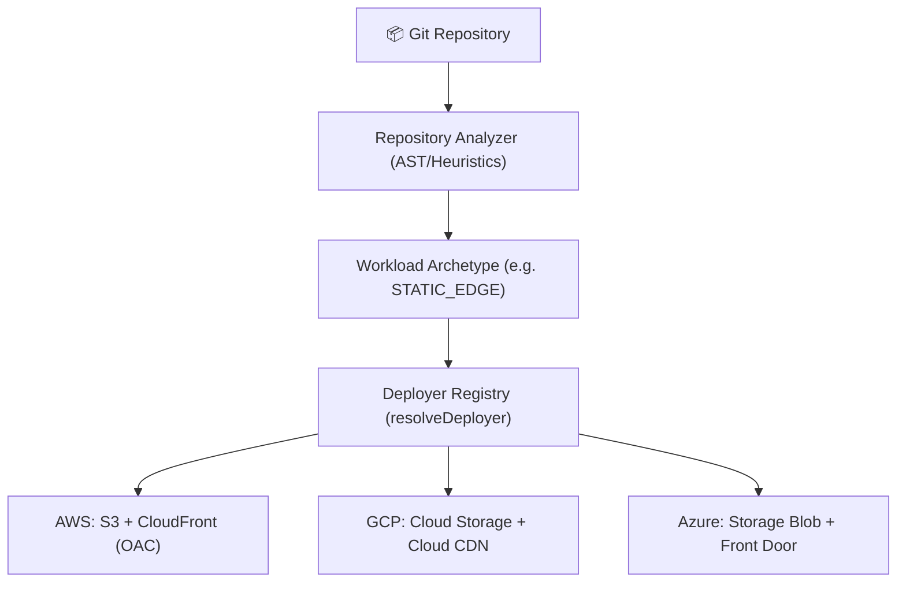

# Multi-Cloud Deployer Registry & Architecture (`DM-901`)

## Overview

The Multi-Cloud Deployer Registry decouples application detection (**Workload Archetype**) from physical infrastructure hosting (**Cloud Provider** and **Execution Tenancy**).

In earlier phases, DeployMate supported only Amazon Web Services (`AWS`). `DM-901` formalizes a two-dimensional matrix allowing any detected workload to resolve to equivalent cloud-native primitives across **AWS**, **Google Cloud Platform (GCP)**, and **Microsoft Azure**.

---

## The 2D Multi-Cloud Mapping Matrix



| Workload Archetype (`WorkloadArchetype`) | AWS (`AWS` - Active Phase 1-9) | GCP (`GCP` - Phase 10) | Azure (`AZURE` - Phase 11) |
| :--- | :--- | :--- | :--- |
| **`STATIC_EDGE`** (Vite, React, Vue, HTML SPAs) | `S3_CLOUDFRONT` | `GCP_STORAGE_CDN` | `AZURE_STATIC_FRONTDOOR` |
| **`CONTAINER_SERVICE`** (Docker, Express, FastAPI) | `ECS_FARGATE` | `GCP_CLOUD_RUN` | `AZURE_CONTAINER_APPS` |
| **`SERVERLESS_FUNC`** (Lambda Handlers, Python Functions) | `LAMBDA_API_GATEWAY` | `GCP_CLOUD_FUNCTIONS` | `AZURE_FUNCTIONS` |
| **`SSR_WEB`** (Next.js SSR, Nuxt) | `AMPLIFY` | `GCP_CLOUD_RUN` | `AZURE_CONTAINER_APPS` |

---

## Tenancy Modes

DeployMate supports two execution tenancies across all supported clouds:

1. **`DEPLOYMATE_MANAGED`**:
   - Workloads run inside DeployMate's multi-tenant cloud infrastructure.
   - Zero cloud configuration required for developers, students, and hobbyists.
2. **`CUSTOMER_BYOC` (Bring Your Own Cloud)**:
   - Workloads deploy directly into the customer's AWS, GCP, or Azure subscription.
   - Authenticated via keyless OpenID Connect (OIDC) federation (no long-lived cloud keys stored).
   - Allows enterprises to consume their cloud credits without markup.

---

## Architecture & Code Implementation

### 1. Unified Interface: `IDeployer`
Located at: [`backend/src/deployers/baseDeployer.ts`](file:///Users/mahen/projects/deploy-mate/backend/src/deployers/baseDeployer.ts)

Every deployer (AWS, GCP, Azure) implements a uniform interface:
- `validateCompatibility(analysis: AnalysisResult)`: Pre-flight checks before provisioning.
- `deploy(ctx: DeployContext)`: Provisions cloud infrastructure and uploads build artifacts.
- `cleanup(record: DeploymentRecord, dryRun: boolean)`: Tears down all cloud resources and releases DNS.

### 2. Resolution & Pre-Flight Reservation Safety
Located at: [`backend/src/deployers/index.ts`](file:///Users/mahen/projects/deploy-mate/backend/src/deployers/index.ts)

```typescript
export function resolveDeployer(
  provider: CloudProvider,
  archetypeOrTarget: WorkloadArchetype | DeploymentTarget
): IDeployer;
```

`resolveDeployer` is invoked in `deploymentManager.ts` **prior** to reserving atomic Route 53 subdomains. When an upcoming cloud provider (e.g., GCP or Azure) is requested before its phase rollout:
- The registry throws a `CloudProviderNotAvailableError` (`HTTP 501 CLOUD_PROVIDER_COMING_SOON`).
- The DNS reservation transaction never executes, preventing leaked or locked hostnames.

---

## API Endpoints

- **`GET /api/clouds`**: Returns the complete catalog of supported cloud providers, roadmap statuses, supported tenancies, and target mappings.
- **`POST /api/deploy`**: Accepts optional `cloudProvider`, `archetype`, and `tenancy` fields in request payloads.
