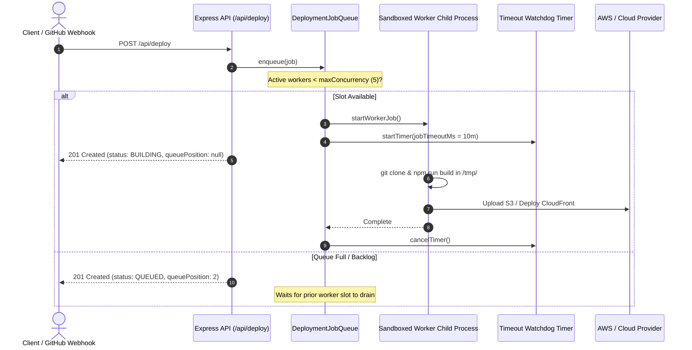

# Bounded Worker Queue & Execution Isolation (`DM-903`)

## Overview

The Bounded Asynchronous Deployment Queue decouples long-running build/deploy tasks from the synchronous Express HTTP request-response cycle. It protects backend servers from out-of-memory (OOM) crashes, starvation, and hanging build processes.

---

## Architecture Diagram



---

## Problems Solved

1. **CPU & Memory Exhaustion (OOM):**
   - Compiling frontend or SSR applications (`next build`, `vite build`) consumes 1.5 GB to 2.5 GB of RAM per process.
   - Without a concurrency ceiling, 10 parallel builds would exhaust server memory, crashing the entire web API.
   - `DM-903` sets `maxConcurrency = 5` by default, keeping server memory within predictable bounds.

2. **HTTP Request Timeouts:**
   - Large application builds can take 2-5 minutes.
   - Reverse proxies (Cloudflare, AWS ALB, NGINX) drop connections exceeding 30-60 seconds.
   - `POST /api/deploy` returns in `<20ms` with `status: QUEUED` or `status: BUILDING`, while build logs stream over Server-Sent Events (SSE).

3. **Stalled & Hanging Builds:**
   - Interactive CLI prompts (e.g., `npm` waiting for user input) or infinite loops in build scripts would lock worker threads permanently.
   - A background watchdog terminates processes exceeding `jobTimeoutMs` (10 minutes), logs a `BUILD_TIMEOUT` error, and automatically releases the slot for the next queued job.

---

## Detailed Code Implementation

Located at: [`backend/src/services/deploymentJobQueue.ts`](file:///Users/mahen/projects/deploy-mate/backend/src/services/deploymentJobQueue.ts)

### 1. Concurrency & Backlog Limits
```typescript
this.maxConcurrency = options?.maxConcurrency ?? Number(process.env.MAX_CONCURRENT_DEPLOYMENTS || 5);
this.jobTimeoutMs = options?.jobTimeoutMs ?? Number(process.env.MAX_DEPLOYMENT_DURATION_MS || 600_000);
this.maxQueueBacklog = options?.maxQueueBacklog ?? Number(process.env.MAX_DEPLOYMENT_QUEUE_BACKLOG || 100);
```

### 2. State Progression
- **`QUEUED`**: The job has been accepted and assigned a 1-based `queuePosition`.
- **`BUILDING`**: The job was dequeued and is actively compiling in an isolated directory.
- **`DEPLOYING`**: Compilation succeeded; cloud infrastructure is provisioning.
- **`LIVE` / `FAILED`**: Terminal states. The slot is freed, calling `drain()` to immediately promote the next queued job.

### 3. Real-Time Server-Sent Events (SSE)
- **`GET /api/deploy/:id/stream`**:
  - Sets `Content-Type: text/event-stream`.
  - Streams state transitions (`status`), `queuePosition`, and audit logs as they happen without polling.
  - Automatically terminates connection when deployment reaches `LIVE`, `FAILED`, or `DELETED`.

---

## API & Monitoring Endpoints

- **`GET /api/queue/status`**:
  ```json
  {
    "backend": "bounded-worker-queue",
    "maxConcurrency": 5,
    "activeWorkers": 1,
    "queuedJobs": 0,
    "jobTimeoutMs": 600000,
    "queuedDeploymentIds": []
  }
  ```
