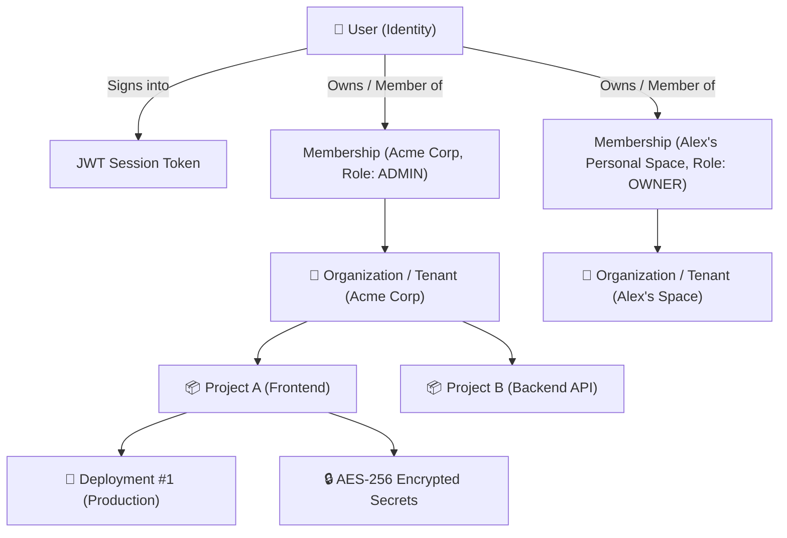

# Multi-Tenant Authentication, Workspaces & RBAC (`DM-904` & `DM-905`)

## Overview

DeployMate implements an enterprise-grade multi-tenant architecture designed to isolate users, organizations, and workloads. It provides:
1. **Stateless JWT Session Management** (`DM-904`).
2. **Automatic Personal Workspace Provisioning & `.edu` Student Verification** (`DM-904`).
3. **Role-Based Access Control (RBAC)** across four permission tiers (`DM-905`).
4. **Anti-IDOR Protection** ensuring cross-tenant data boundaries (`DM-905`).

---

## Multi-Tenant Data Hierarchy

---

## 1. Authentication & Session Management (`DM-904`)

Located at: [`backend/src/services/authService.ts`](file:///Users/mahen/projects/deploy-mate/backend/src/services/authService.ts)

- **Providers Supported**: GitHub OAuth, Google OAuth, and passwordless email session authentication.
- **Tokens**: HMAC-SHA256 signed JSON Web Tokens (7-day validity) containing `userId`, `email`, active `orgId`, and current `role`.
- **Active Org Switching**: Clients send an `X-Org-Id` header to scope operations to any organization where they hold an active membership.

### Student Verification (`.edu` Detection)
During session creation, the user's email domain is inspected against academic Top-Level Domains (`.edu`, `.ac.uk`, `.edu.in`, etc.) and top university domains. When verified:
- `studentVerified: true` is stamped on the user profile.
- A free `CAMPUS_FREE` organization plan tier is automatically provisioned.

---

## 2. Role-Based Access Control (RBAC) Matrix (`DM-905`)

DeployMate strictly partitions administrative, deployment, and view capabilities across four standardized roles:

| Action / Capability | `OWNER` | `ADMIN` | `DEVELOPER` | `VIEWER` |
| :--- | :---: | :---: | :---: | :---: |
| **View Deployments, Metrics & Logs** | ✅ | ✅ | ✅ | ✅ |
| **Deploy to Preview / Staging** | ✅ | ✅ | ✅ | ❌ |
| **Deploy to Production** | ✅ | ✅ | ❌ | ❌ |
| **1-Click Instant Production Rollback** | ✅ | ✅ | ❌ | ❌ |
| **Connect GitHub App Installation** | ✅ | ✅ | ❌ | ❌ |
| **Manage / Add Environment Secrets** | ✅ | ✅ | ❌ | ❌ |
| **Invite Team Members / Assign Roles** | ✅ | ❌ | ❌ | ❌ |
| **Delete Cloud Infrastructure Stacks** | ✅ | ❌ | ❌ | ❌ |

---

## 3. Anti-IDOR (Insecure Direct Object Reference) Protection

Located at: [`backend/src/middleware/authMiddleware.ts`](file:///Users/mahen/projects/deploy-mate/backend/src/middleware/authMiddleware.ts)

When accessing projects, deployments, or encrypted secrets via path parameters (`/projects/:projectId`):
- DeployMate checks that the target resource belongs strictly to the requester's `activeOrgId`.
- If an entity belongs to another tenant, the API responds with **`HTTP 404 Not Found`** (instead of `403 Forbidden`).
- **Security Impact**: Unauthorized actors cannot probe or enumerate resource IDs across different organizations.

---

## API Endpoints

- **`POST /api/auth/session`**: Signs in or registers a user, returning a JWT and their organizations.
- **`GET /api/auth/me`**: Returns the active session profile and organization roles.
- **`POST /api/orgs`**: Creates a new team organization (assigning the caller as `OWNER`).
- **`POST /api/orgs/:orgId/members`**: Invites a team member with a specified role (`ADMIN`, `DEVELOPER`, `VIEWER`).
