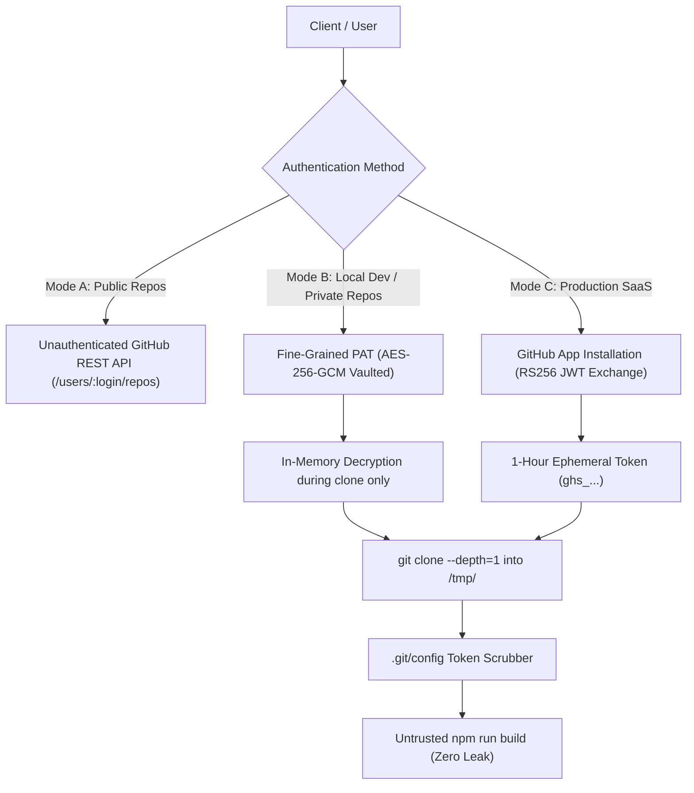

# GitHub App Integration & Zero-Exfiltration Isolation (`DM-906`)

## Overview

DeployMate provides deep GitHub integration for both **public** and **private** repositories. It uses official GitHub App RS256 token exchange in production, provides vaulted developer token support locally, and enforces strict build isolation to prevent credential exfiltration.

---

## Authentication Modes



### 1. Mode A: Instant Public Discovery (Zero Setup)
- Requires no tokens or credentials.
- Directly inspects public repositories on `api.github.com/users/:owner/repos` and retrieves branches.

### 2. Mode B: Local Development / Fine-Grained Tokens
- Used when running DeployMate locally on `localhost` where GitHub App OAuth callbacks cannot reach.
- Accepts a GitHub Fine-Grained Token (`github_pat_...`) with read-only permissions (`Contents: Read-only`, `Metadata: Read-only`).
- **Storage Security**: Tokens are immediately encrypted using **AES-256-GCM** authenticated envelope encryption bound to the organization and installation ID (`gh_inst:<orgId>:<installationId>`). No plaintext token is ever written to disk or returned in API responses.

### 3. Mode C: Production Official GitHub App
Located at: [`backend/src/services/githubAppService.ts`](file:///Users/mahen/projects/deploy-mate/backend/src/services/githubAppService.ts)
- Signs an RS256 JWT using Node's `crypto` module valid for 9 minutes:
  ```typescript
  public signAppJwt(appId: string, privateKeyPem: string): string
  ```
- Exchanges the App JWT for an ephemeral, 1-hour GitHub installation token (`ghs_...`) via `POST https://api.github.com/app/installations/:id/access_tokens`.

---

## Zero-Exfiltration Defense (`DM-906 AC2`)

Untrusted repositories could attempt to execute malicious build scripts (e.g., `preinstall` or `build` scripts in `package.json`) to dump `.git/config` or environment variables and exfiltrate GitHub tokens.

DeployMate implements a two-stage defense:

1. **`.git/config` Scrubbing**:
   [`scrubGitConfigCredentials`](file:///Users/mahen/projects/deploy-mate/backend/src/services/githubAppService.ts#L557-L574) runs immediately after `git clone` finishes:
   - Strips embedded URL credentials: `https://x-access-token:<TOKEN>@github.com/...` &rarr; `https://github.com/...`
   - Strips `extraheader = AUTHORIZATION: basic/bearer ...` lines.
   - Cleanses any stray `ghs_*`, `ghp_*`, or `github_pat_*` tokens.

2. **Environment Variable Whitelisting**:
   - Strips `AWS_ACCESS_KEY_ID`, `AWS_SECRET_ACCESS_KEY`, `GITHUB_*`, and `SECRETS_MASTER_KEY` before spawning `npm run build`.

---

## API Endpoints

- **`POST /api/github/installations`**: Connects a GitHub App or account login to an organization (requires `OWNER` or `ADMIN` role).
- **`GET /api/github/repos`**: Returns paginated public and private repositories accessible by the organization's installations.
- **`POST /api/analyze`**: Runs deep framework analysis on any public or private repository using ephemeral installation tokens.
