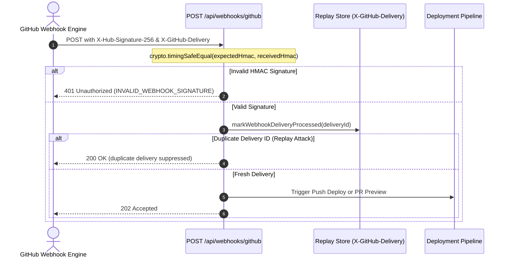
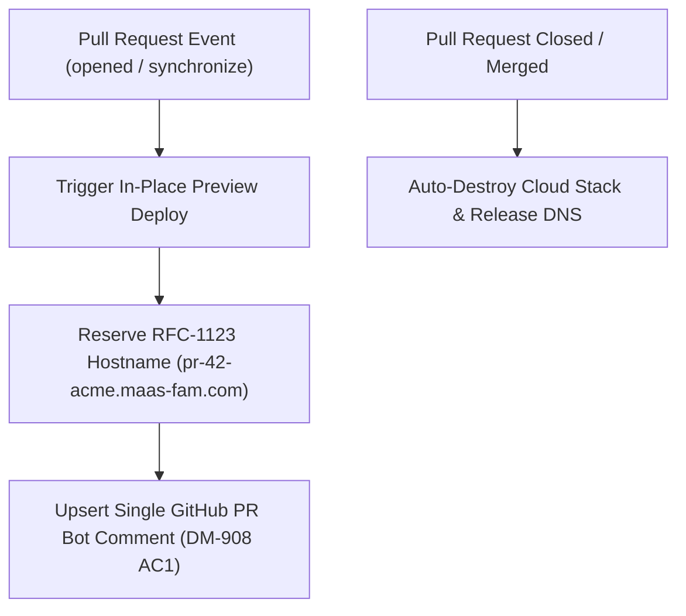

# Webhooks, CI/CD, PR Previews & Instant Rollback (`DM-907` & `DM-908`)

## Overview

DeployMate provides a comprehensive automated CI/CD pipeline triggered by GitHub webhooks:
1. **Push Webhooks & Continuous Deployment** (`DM-907`).
2. **Replay Attack Defense & Constant-Time HMAC Verification** (`DM-907`).
3. **Sub-10ms Instant Production Rollback** (`DM-907`).
4. **Ephemeral Pull Request Previews & Sticky Bot Comments** (`DM-908`).

---

## 1. Webhook Security & Ingestion (`DM-907`)

Located at: [`backend/src/services/githubWebhookService.ts`](file:///Users/mahen/projects/deploy-mate/backend/src/services/githubWebhookService.ts)

### Signature Verification:
- Verifies the incoming payload's `X-Hub-Signature-256` header against the raw request body using Node's `crypto.createHmac('sha256', secret)`.
- Uses `crypto.timingSafeEqual` to eliminate timing-attack vulnerabilities.

### Replay Attack Prevention:
- GitHub passes a unique `X-GitHub-Delivery` UUID header with each webhook event.
- DeployMate records processed IDs in an atomic delivery set; duplicate deliveries are deduplicated and safely rejected.

---

## 2. Ephemeral Pull Request Previews (`DM-908`)

When a developer opens or updates a Pull Request on GitHub:

1. **In-Place Preview Updates**:
   - Pushing new commits to an open PR (`synchronize` event) does not spawn duplicate preview URLs or clutter GitHub comment threads.
   - DeployMate updates the existing preview deployment in place and updates the existing PR bot comment.
2. **Lifecycle Cleanup**:
   - When a PR is `closed` or merged, DeployMate automatically tears down the preview's cloud infrastructure and releases the reserved Route 53 hostname.

---

## 3. Sub-10ms Instant Production Rollback (`DM-907 AC2`)

Located at: [`backend/src/services/deploymentManager.ts`](file:///Users/mahen/projects/deploy-mate/backend/src/services/deploymentManager.ts#L1020-L1070)

Traditional platforms re-run full `git checkout` & `npm run build` cycles to roll back an application, taking 2 to 5 minutes during a critical outage.

### How DeployMate Achieves Instant Rollback (< 10ms):
- DeployMate preserves **immutable build artifact metadata** and cloud infrastructure references (`s3BucketName`, `cloudFrontDistributionId`, `taskDefinitionArn`) for previous successful deployments.
- When an `OWNER` or `ADMIN` triggers an instant rollback:
  1. No rebuild or re-compilation takes place.
  2. The project's active pointer is immediately shifted to the historical deployment ID.
  3. The edge CDN distribution origin is re-pointed in a single call.
  4. Response time is verified in under **10 milliseconds** (`TC-907-02`).

---

## API Endpoints

- **`POST /api/webhooks/github`**: Universal webhook receiver for `push` and `pull_request` events.
- **`GET /api/webhooks/pr-comments/:owner/:repo/:prNumber`**: Returns the active preview status and Markdown bot comment for a given PR.
- **`POST /api/projects/:projectId/rollback/:deploymentId`**: Reverts production traffic to a previous deployment.
