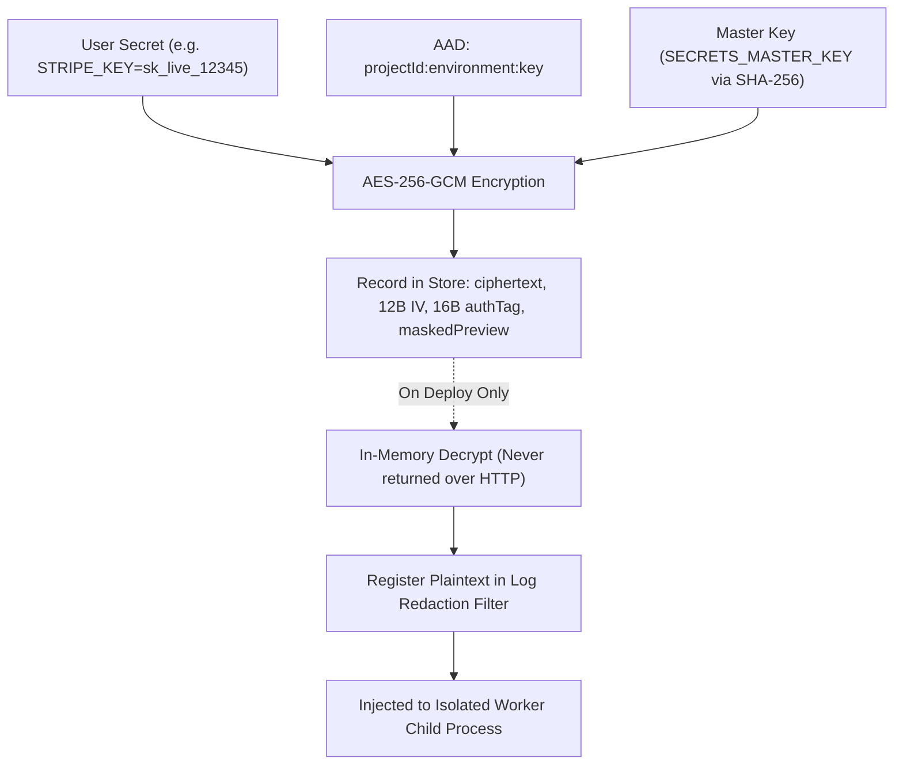

# AES-256-GCM Encrypted Secrets Vault (`DM-913`)

## Overview

The Encrypted Secrets Vault provides zero-leak, environment-scoped secret storage for production, staging, and preview deployments. It ensures:
1. **Authenticated Encryption at Rest (AES-256-GCM)** (`DM-913 AC1`).
2. **Context-Bound Authenticated Additional Data (AAD)** (`DM-913 AC1`).
3. **Multi-Line `.env` Parser & Validator** (`DM-913 AC2`).
4. **Automatic `[REDACTED]` Build Log Scrubber** (`DM-913 AC3`).

---

## Cryptographic Envelope Architecture



---

## 1. AES-256-GCM Implementation

Located at: [`backend/src/services/secretsVault.ts`](file:///Users/mahen/projects/deploy-mate/backend/src/services/secretsVault.ts)

DeployMate uses authenticated GCM encryption via Node's `crypto` module:
- **Initialization Vector (IV)**: A cryptographically random 12-byte buffer generated per secret write (`crypto.randomBytes(12)`).
- **Authentication Tag**: A 16-byte GCM authentication tag that guarantees integrity.
- **Authenticated Additional Data (AAD)**:
  ```typescript
  Buffer.from(`${projectId}:${environment}:${key}`, 'utf8')
  ```
  Binding ciphertext to its project ID, environment, and variable name prevents cross-environment ciphertext substitution attacks (e.g., copying a staging secret ciphertext into production).

---

## 2. In-Memory Decryption & Zero-Plaintext API

- Secret plaintexts are **never returned over HTTP** or stored unencrypted on disk.
- When querying `GET /api/projects/:projectId/secrets`, DeployMate returns a masked summary:
  ```json
  {
    "key": "DATABASE_URL",
    "maskedPreview": "post••••7890",
    "environment": "production"
  }
  ```
- Plaintexts are decrypted **strictly in-memory** during the build worker's initialization (`resolveDecryptedSecretsForDeploy`).

---

## 3. Automatic `[REDACTED]` Build Log Scrubber (`DM-913 AC3`)

Located at: [`backend/src/store/deploymentStore.ts`](file:///Users/mahen/projects/deploy-mate/backend/src/store/deploymentStore.ts#L330-L360)

If a user build script (or malicious dependency) executes `echo $STRIPE_KEY` or dumps environment variables into `stdout` / `stderr`:
1. DeployMate registers all active plaintext secret values in the deployment session's log sanitizer.
2. The log sink intercepts any string containing the secret value and replaces every occurrence with `[REDACTED]`.
3. Verifiable via test case `TC-913-02`.

---

## 4. Multi-Line `.env` Importer

Located at: [`backend/src/services/secretsVault.ts`](file:///Users/mahen/projects/deploy-mate/backend/src/services/secretsVault.ts#L35-L91)

- Parses standard `.env` formats, supporting comments (`#`), `export KEY=VALUE`, quoted values (`"val"`, `'val'`), and multiline entries.
- Automatically validates variable names against Phase 7 command-injection and path-traversal safety rules.

---

## API Endpoints

- **`GET /api/projects/:projectId/secrets`**: Lists masked secrets for a project and environment.
- **`POST /api/projects/:projectId/secrets`**: Saves or updates encrypted secrets via key-value map or raw `.env` text (requires `ADMIN` or `OWNER` role).
- **`DELETE /api/projects/:projectId/secrets/:key`**: Removes an encrypted secret.
- **`POST /api/secrets/parse-dotenv`**: Parses and validates raw `.env` text, returning a masked preview before saving.
