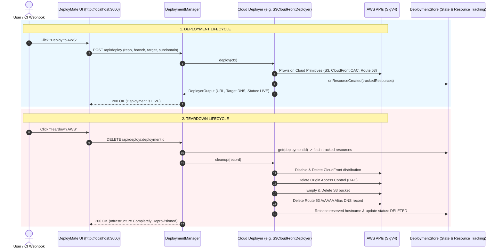

# AWS Infrastructure Provisioning & Teardown Lifecycle

## Overview

A fundamental architectural principle of DeployMate is **zero manual infrastructure management**. Users and developers should not need to write, configure, or execute manual Terraform / CloudFormation scripts out-of-band in a terminal to deploy applications.

DeployMate dynamically provisions cloud primitives on demand during deployment, tracks all generated resources by deployment ID, and guarantees a 1-click clean **Teardown** that wipes all provisioned resources without leaving orphan cloud artifacts or ongoing billing charges.

---

## Deployment & Teardown Architecture



---

## Automated Resource Tracking

Every deployment records its exact cloud infrastructure footprint inside [`TrackedCloudResources`](file:///Users/mahen/projects/deploy-mate/backend/src/types/deployment.ts):

```typescript
export interface TrackedCloudResources {
  provider?: CloudProvider;
  s3BucketName?: string;
  cloudFrontOacId?: string;
  cloudFrontDistributionId?: string;
  cloudFrontDomainName?: string;
  acmCertificateArn?: string;
  route53HostedZoneId?: string;
  route53RecordName?: string;
  ecrRepositoryUri?: string;
  ecsClusterName?: string;
  ecsServiceName?: string;
  ecsTaskDefinitionArn?: string;
  albTargetGroupArn?: string;
  albListenerRuleArn?: string;
  lambdaFunctionName?: string;
  apiGatewayId?: string;
  amplifyAppId?: string;
}
```

Because resource IDs are bound to the specific `deploymentId`, a teardown operation knows exactly what to delete without affecting any other running deployment or tenant.

---

## Target-by-Target Lifecycle Comparison

| Target | Dynamic Provisioning Action | UI 1-Click Teardown Action |
| :--- | :--- | :--- |
| **`S3_CLOUDFRONT`** (Static Edge) | Creates private S3 bucket, uploads assets, creates CloudFront OAC + Distribution, creates Route 53 Alias. | Disables & deletes CloudFront distribution, removes OAC, empties and deletes S3 bucket, deletes Route 53 DNS record. |
| **`ECS_FARGATE`** (Containers) | Builds & pushes image to Amazon ECR, registers Task Definition, creates ALB Target Group + Listener Rule, creates ECS Service. | Deletes ECS Service (draining tasks), deregisters Task Definition, deletes ALB Target Group + Listener Rule, deletes ECR repository. |
| **`LAMBDA_API_GATEWAY`** (Serverless) | Packages in-memory PKZIP archive, creates AWS Lambda function, creates API Gateway v2 HTTP API route. | Deletes API Gateway v2 HTTP API and routes, deletes AWS Lambda function and associated CloudWatch log groups. |
| **`AMPLIFY`** (Managed SSR) | Provisions AWS Amplify App with `WEB_COMPUTE` SSR platform, connects production branch. | Calls Amplify `DeleteApp`, deleting all backend compute and edge branches. |

---

## Dry-Run Simulation vs. Real AWS Execution

DeployMate supports seamless toggling between local simulated execution and real cloud operations via `.env`:

### 1. Dry-Run Mode (`AWS_DRY_RUN=true`)
- Useful for local feature development and UI testing.
- Real AST analysis and isolated builds run on the machine.
- AWS API calls are simulated; synthetic resource IDs (e.g. `repo2cloud-static-dep_1234`) are generated.
- No charges incurred on AWS.

### 2. Live AWS Mode (`AWS_DRY_RUN=false`)
- Real calls are signed with AWS SigV4 using the configured `AWS_ACCESS_KEY_ID` and `AWS_SECRET_ACCESS_KEY`.
- Real cloud infrastructure is provisioned in the chosen `AWS_REGION` (default `us-east-1`).
- Real DNS records are published globally on Route 53.
- Clicking **Teardown AWS** executes real deprovisioning calls against AWS APIs.

---

## API Endpoints

- **`POST /api/deploy`**: Initiates end-to-end cloud provisioning for a repository.
- **`DELETE /api/deploy/:id`**: Tears down all cloud resources associated with the deployment and releases the reserved subdomain.
- **`GET /api/deploy/:id`**: Returns live deployment status, checklist progress, and active cloud resource ARNs.
