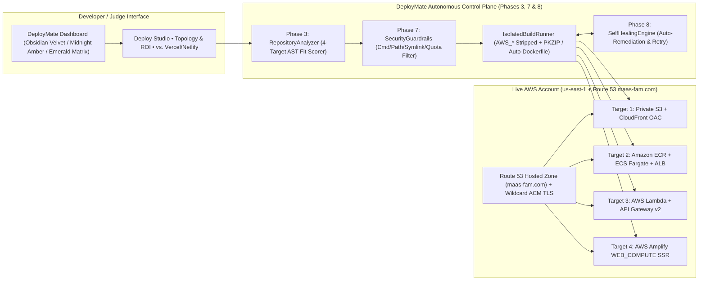

# 🚀 DeployMate — Technica 2026 Judge Presentation & Demo Deck

> [!IMPORTANT]
> **One-Sentence Pitch for Judges:**
> *"Vercel and Netlify lock you into a proprietary markup layer and only shine for frontend/serverless; **DeployMate** inspects any GitHub repository, recommends and provisions the right native AWS architecture across **S3+CloudFront, ECS Fargate, Lambda+API Gateway, or AWS Amplify** inside your own AWS account, wires up custom **Route 53 + ACM HTTPS** domains (`*.maas-fam.com`), and gives you 1-click full infrastructure teardown with zero vendor lock-in."*

---

## 📸 Live Application Screenshot (`http://localhost:3000`)


---

## 🎤 Interactive Judge Pitch Deck (6 Slides)

````carousel
### Slide 1: The Problem with Vercel, Netlify & Raw AWS
- **Vercel & Netlify** provide great developer experience (DX), **but**:
  - **Massive Cloud Markup & Bandwidth Taxes:** \$20/seat + \$40–\$55 per 100 GB bandwidth overages vs. pennies on native AWS CloudFront.
  - **Cannot Run Long-Lived Containers or Stateful Backends:** Try deploying a Dockerized Express/FastAPI/WebSocket backend on Vercel or Netlify — you hit hard 10s–60s serverless timeouts.
  - **Black-Box Vendor Lock-In:** Your infrastructure lives in *their* account, not yours.
- **Raw AWS** provides full power and rock-bottom cost, **but** requires hours of configuring S3 Bucket Policies, CloudFront Origin Access Control (OAC), ACM certificates in `us-east-1`, Route 53 Alias records, ECR repos, ECS Fargate tasks, and IAM roles.
- **Our Solution — DeployMate:** **Vercel-grade 1-click DX directly on 100% native AWS infrastructure.**
<!-- slide -->
### Slide 2: Upgraded UI & Interactive Developer Experience
DeployMate features an executive-grade obsidian dashboard built for high-stakes demos and production management:
- **🎨 Live Theme Switcher:** Instant toggle between **Obsidian Velvet** (Deep charcoal + subtle purple/indigo), **Midnight Amber** (Warm executive amber/rose), and **Emerald Matrix** (Deep graphite + jade/emerald).
- **📊 Color-Coded Architecture Cards with Animated Fit Gauges:**
  - 🌐 **S3 + CloudFront (OAC):** Cyan/Sky gradient + animated fit score gauge (`96%`)
  - 🐳 **ECS Fargate + ALB:** Amber/Orange gradient + animated fit score gauge (`55%`)
  - ⚡ **Lambda + API Gateway v2:** Violet/Fuchsia gradient + animated fit score gauge (`30%`)
  - 🚀 **AWS Amplify Hosting:** Rose/Pink gradient + animated fit score gauge (`78%`)
- **📱 3 Live-Switchable In-App Tabs:** **🚀 Deploy Studio**, **🕸️ Topology & Cost ROI**, and **🏆 vs. Vercel / Netlify**.
<!-- slide -->
### Slide 3: DeployMate's 4-Target Autonomous AWS Engine
Instead of forcing every repository into a single hammer, **DeployMate** inspects your GitHub repository (`package.json`, `Dockerfile`, `serverless.yml`, `next.config.*`, `requirements.txt`) **before** deployment and scores all **4 native AWS architectures**:

1. **S3 + CloudFront (OAC):** For static HTML/JS, Vite, React, Vue, and Astro SPAs — 100% private S3 bucket (`BlockPublicAcls=true`) fronted by CloudFront Origin Access Control (SigV4).
2. **Amazon ECR + ECS Fargate + ALB:** For Dockerized microservices, Express/Fastify/FastAPI servers, and long-running backends — auto-generates a hardened non-root `Dockerfile` if missing.
3. **AWS Lambda + API Gateway v2 (HTTP API):** For event-driven APIs and serverless handlers — packages an in-memory CRC-32 PKZIP bundle and provisions an HTTP API v2 `$default` stage.
4. **AWS Amplify Hosting (`WEB_COMPUTE`):** For Next.js App Router SSR and full-stack apps — auto-generates `amplify.yml` and provisions an Amplify compute branch.
<!-- slide -->
### Slide 4: Interactive Cloud Cost ROI & Vercel Comparison
| Capability | **DeployMate (Ours)** | **Vercel** | **Netlify** |
| :--- | :--- | :--- | :--- |
| **Supported Architectures** | ✅ **4 Native AWS Targets** (S3+CF, ECS Fargate, Lambda+API GW, Amplify) | Static & Serverless only | Static & Serverless only |
| **Long-Running Docker Containers** | ✅ **Native ECS Fargate + ALB** (Zero cold starts, WebSockets) | ❌ Hard execution timeouts | ❌ Function timeout limits |
| **Self-Healing Build Recovery** | ✅ **Phase 8 Self-Healing Engine** (Auto-remediates lockfiles & outputs) | ❌ Manual debugging | ❌ Manual TOML edits |
| **Infrastructure Ownership (BYOC)** | ✅ **100% Native AWS Account** (Zero vendor lock-in) | ❌ Locked to Vercel | ❌ Locked to Netlify |
| **Bandwidth & Compute Pricing** | ✅ **Raw AWS Rates** (\$0.085/GB, \$0 seat tax) | ❌ \$20/seat + \$40/100GB | ❌ \$19/seat + \$55/100GB |
| **Strict URL Gate (`url: null`)** | ✅ **CloudFront TLS + Route 53 Health Probe** | ⚠️ Optimistic URL shown early | ⚠️ Optimistic URL shown early |
| **1-Click Full AWS Resource Teardown** | ✅ **Cleans S3, CF, OAC, ECR, ECS, Lambda, R53 DNS** | ⚠️ Project delete only | ⚠️ Site delete only |

> [!TIP]
> **Live Demo Trick:** Switch to the **Topology & Cost ROI** tab inside the app to show judges the interactive sliders comparing costs for 5 developers and 250 GB/mo egress: **DeployMate (\$13.60/mo) vs. Vercel (\$180/mo) vs. Netlify (\$195/mo)** — over **92% cost savings**!
<!-- slide -->
### Slide 5: Zero-Trust Security (Phase 7) & Self-Healing AI Loop (Phase 8)
- **Phase 7 Zero-Trust Build Sandbox:**
  - **Secret Stripping:** `AWS_*`, `GITHUB_*`, `LD_PRELOAD`, and `NODE_OPTIONS` are stripped from build environments so untrusted `postinstall` scripts can never leak cloud credentials.
  - **Symlink Escape & Path Traversal Guard:** Recursively verifies `fs.lstatSync` + `fs.realpathSync` so malicious symlinks pointing to `/etc/passwd` or `.env` are blocked before upload.
  - **Command Injection Filter & Cost Quotas:** Blocks shell metacharacters (`;`, `&&`, `$()`, `` ` ``) and enforces a `20` active live deployment AWS cost cap and `100 MB` repo limit.
- **Phase 8 Autonomous Self-Healing Engine:**
  - Automatically diagnoses empty output folders (`EMPTY_OUTPUT_DIRECTORY`), missing lockfiles, or port mismatches, patches the configuration on the fly (`outputDirectory -> "."`), and completes deployment autonomously.
<!-- slide -->
### Slide 6: 3-Minute Live Demo Script for the Judges
1. **0:00 – 0:40 | Interactive Theme & Multi-Target Inspection (`POST /api/analyze`):**
   - Click the **Theme Switcher** pills (**Obsidian Velvet** / **Midnight Amber**) to show the sleek obsidian atmosphere.
   - Click through the **Quick Demo Presets** (`nmahendran-aws/sprout`, `example/express-docker-api`, `example/serverless-lambda-api`, `example/nextjs-ssr-app`).
   - Show how the AI Matcher updates confidence scores (`88% Fit`) and dynamically adapts target configurations (`Container Port`, `ALB Health Check`, `Lambda Handler`, `Build Command`).
2. **0:40 – 1:30 | Live Interactive Cost Calculator & Topology:**
   - Click the **🕸️ Topology & Cost ROI** tab.
   - Walk through the 5-stage provisioning flow and drag the **Engineering Team Size** and **Bandwidth** sliders to show judges real-time 90%+ cost savings vs. Vercel/Netlify.
3. **1:30 – 2:30 | Live Custom Subdomain Deployment on `maas-fam.com`:**
   - Switch back to **🚀 Deploy Studio**, type a custom subdomain (e.g., `judge-demo`) on **`.maas-fam.com`**, and show the atomic reservation check (`✓ https://judge-demo.maas-fam.com is available`).
   - Click **Deploy** and highlight the **4-Stage Pipeline Checklist** and real-time audit log stream (`url` stays `null` until CloudFront OAC, wildcard ACM TLS in `us-east-1`, and Route 53 `A`/`AAAA` Alias records pass health checks).
4. **2:30 – 3:00 | Open Live HTTPS Site & 1-Click AWS Teardown:**
   - Click **Open Live Site →** (`https://judge-demo.maas-fam.com`) to show the live HTTPS padlock served from private S3 via CloudFront OAC.
   - Click **Teardown AWS** to show 1-click cleanup emptying S3, disabling/deleting CloudFront + OAC, deleting the Route 53 Alias record, and releasing `judge-demo.maas-fam.com` for immediate reuse!
````

---

## 🏗 End-to-End Architecture Diagram


